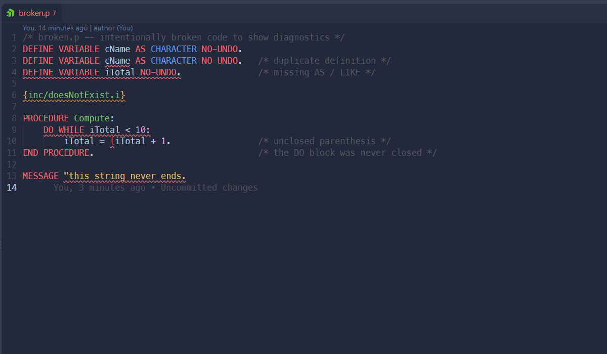
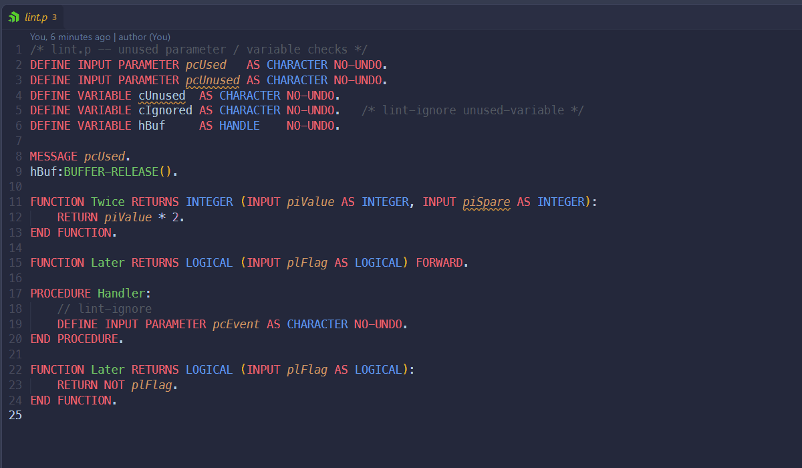

# abl-lsp

[](https://github.com/connor-ve/abl-lsp/actions/workflows/ci.yml)
[](LICENSE)

A language server for Progress OpenEdge ABL, written in Rust, with a VS Code extension.

ABL has very little modern editor tooling. abl-lsp gives it what other languages take for granted: go-to-definition across files, PROPATH and classes, hover docs, completion, rename, a formatter, and lint rules with quick fixes. It works from source alone and needs no OpenEdge install.



## Why this matters with coding agents

LLM coding agents are good at Java, Python and TypeScript because they have seen a huge amount of it. ABL is the opposite: a niche language with little public code, mostly in private enterprise codebases. Agents writing ABL often invent built-in functions, get handle attributes wrong, leave out `NO-UNDO`, and write `FIND` and `FOR EACH` without a lock, which takes SHARE-LOCK by default in production.

A language server gives an agent the ground truth it can't get from training data:

- **Real answers instead of guesses.** Definitions, references, hover and signature help come from the actual workspace, PROPATH, `.df` schema and class hierarchy, not from what the model remembers.
- **A fast feedback loop.** `abl-lsp check FILE...` prints compiler-style diagnostics and lint findings without an OpenEdge install, so an agent can write code, check it, and fix it in seconds.
- **Safe refactoring.** Rename is resolved per scope and follows method overrides, so an agent can change a name across a codebase without find-and-replace mistakes.
- **House style enforced automatically.** Lint rules with quick fixes, plus `abl-lsp format --write`, bring agent-written code into line with what a reviewer expects.

Editors and agent tools increasingly speak LSP directly. A language that has a good server becomes one agents can work in safely. One without stays a guessing game.

## Install

**From a release:** download the `.vsix` from [Releases](https://github.com/connor-ve/abl-lsp/releases), then run:

```powershell
code --install-extension abl-lsp-0.7.0.vsix
```

**From source** (needs Rust and Node.js; Windows):

```powershell
.\build.ps1 -Install
```

Open any folder of `.p`, `.w`, `.i` or `.cls` files. The `samples` folder is a good place to start.

## Features



| Feature | What it does |
|---|---|
| Outline | Procedures, functions, classes, methods, properties, temp-tables (with fields and indexes), buffers, variables, parameters, `ON` triggers, `&GLOBAL/SCOPED-DEFINE` |
| Go to definition | Variables and parameters by scope · internal procedures (`RUN x`) · external procedures (`RUN dir/x.p`, `.r` maps to `.p`/`.w`) · `{include.i}` · `{&NAME}` · `table.field` and `buffer.field` (also when the table is defined in an include) · classes through `USING` · `obj:Member`, `THIS-OBJECT:`, `SUPER:`, inherited members, enum members |
| Hover | Declaration text, kind, and file:line when it lives elsewhere. `LIKE` definitions show the type they resolve to. Keywords show their full name when abbreviated (`DEF` → DEFINE). `{&NAME}` shows the value it expands to |
| Completion | After `tt.` / `buffer.`: fields. After `obj:`: class members, including inherited ones. After a handle (`SESSION:`, `hBuf:`, `BUFFER x:`, `hQuery:GET-BUFFER-HANDLE(1):`): its attributes and methods. After `RUN`: procedures. Otherwise: visible symbols, built-in functions and keywords, matching your case |
| Diagnostics | Unterminated strings, comments and `{`; unbalanced `( )` / `[ ]`; missing `END`; `END PROCEDURE` closing the wrong block; stray `END`; missing final period; duplicate definitions; `DEFINE VARIABLE` without `AS`/`LIKE`; unbalanced `&IF`/`&ENDIF`; include files missing from the PROPATH |
| Lint rules | Configurable per rule (`off`/`hint`/`info`/`warning`/`error`): `unused-parameter`, `unused-variable`, `unused-buffer` (faded like Go's unused names), `missing-no-undo`, `find-without-no-error`, `for-each-without-lock` and `find-without-lock` (database tables only, not temp-tables), `keyword-abbreviation` (hint by default). Suppress with `/* lint-ignore [rule] */` on the line or the line above |
| Quick fixes | Ctrl+. on a finding: **Add NO-UNDO**, **Add NO-ERROR**, **Add NO-LOCK**, **Expand to DEFINE**, **Ignore *rule* on this line**, **Fix all ABL lint issues**. The last also runs on save with `"editor.codeActionsOnSave": { "source.fixAll": "explicit" }` |
| Highlighting | Semantic tokens: keywords (including abbreviations), types, classes, procedures, methods, properties, variables, parameters, preprocessor. `&IF` branches that are not taken are dimmed like comments |
| Preprocessor | `&GLOBAL-DEFINE` / `&SCOPED-DEFINE` / `&UNDEFINE` are tracked, including global names defined in include files. `&IF` / `&ELSEIF` conditions are evaluated (`DEFINED()`, `{&OPSYS}`, `PROVERSION`, comparisons, `AND`/`OR`/`NOT`, `BEGINS`, `MATCHES`, string functions); a condition it cannot evaluate takes the first branch. `{&NAME}` is replaced by its value, so `DEFINE VARIABLE {&VAR} AS {&TYPE}` defines a real variable. Include files are read with their arguments (`{inc/tt.i ttOrder &key=OrderNum}` fills `{1}` and `{&key}`), so tables and fields an include defines from its arguments resolve. Extra names: the `abl.preprocessor` setting |
| Built-in functions and handles | Hover docs and signature help for about 100 built-in functions (`SUBSTRING`, `ENTRY`, `LOOKUP`, `ADD-INTERVAL`...), the system handles (`SESSION`, `ERROR-STATUS`, `THIS-PROCEDURE`, `FILE-INFO`, `COMPILER`, `LOG-MANAGER`...) and the attributes and methods of buffer, buffer-field, query, temp-table, dataset, data-relation, data-source, widget, X-document and server handles. A HANDLE variable takes its kind from `CREATE QUERY h`, `h = BUFFER x:HANDLE` or `h = hBuf:BUFFER-FIELD(...)`; otherwise it offers the common kinds together. The table is `server/builtin/abl-reference.txt` |
| Datasets | `DEFINE DATASET` shows its buffers and data-relations (with their relation fields) in the outline and hover. `DEFINE TEMP-TABLE x ... LIKE table` takes that table's fields wherever `LIKE` appears among the options; `LIKE-SEQUENTIAL` too. `BEFORE-TABLE bttX` is a table with the same fields. `DATASET ds:` / `TEMP-TABLE tt:` / `BUFFER b:` complete their handle attributes |
| Formatting | Format Document / Format Selection: indents one level per block (`END` lines up with its header), keeps the offset of continuation lines, lines `DO:` up with `IF ... THEN` / `ON ...` on the line above, indents property `GET`/`SET`, and trims trailing white space. Preprocessor lines, inactive branches and the inside of strings are left alone. Optional keyword case with `abl.format.keywordCase`. Also `abl-lsp format [--write] FILE...` |
| Workspace symbols | Ctrl+T across every `.p .w .i .cls` in the workspace, plus database tables |
| Database schema | `.df` dumps give database tables and fields go-to-definition (into the .df), hover (type, format, label, description) and completion (`customer.`, `buffer.`, `dbname.`). Works with `db.table.field` and buffers `FOR` db tables. Unqualified field names (`FOR EACH Order WHERE CustNum = 1`) resolve to the table of the record phrase they are in, then to enclosing `FOR EACH` blocks; completion there lists those tables' fields first |
| References / rename | Shift+F12 and F2 across the workspace. Each occurrence is resolved, so same-named variables in other scopes are left alone. Renaming a method renames the methods it overrides and its overrides in subclasses. Classes, schema items and built-ins are refused |
| Highlights | Other occurrences of the symbol under the cursor |
| Classes | Chains (`oSvc:GetOrder():Customer:Name`), static access (`Square:Make()`), `CAST(x, T):`, `NEW T():`, `SUPER:`, `THIS-OBJECT:`. Overloads resolve by the types of the arguments (literals, variables, fields, `LIKE`, method and built-in function results, `NEW T()`, comparisons), with INTEGER → INT64 → DECIMAL widening and subclasses accepted for a class parameter; by count when a type is unknown. Every class inherits `Progress.Lang.Object`, and `Progress.Lang.*` is always in scope |
| Built-in classes | Stubs for `Progress.Lang.*` (Object, Class, Error, ProError, AppError, SysError, Stop, StopError) and `Progress.Json.ObjectModel.*` (JsonObject, JsonArray, JsonConstruct, ObjectModelParser, JsonDataType) give completion, hover, signature help and F12 into the stub. Stubs live in `server/builtin/` |
| Class contracts | Errors for a concrete class missing an interface or `ABSTRACT` member (`missing-implementation`), a method overriding a superclass method without `OVERRIDE` (`missing-override`, quick fix **Add OVERRIDE**), and `OVERRIDE` with nothing to override (`override-without-base`). Skipped when a superclass or interface cannot be found |
| Signature help | Parameter hints for functions, methods, built-in functions, handle methods, `NEW Class(`, `RUN proc (` and `RUN file.p (`. Overloaded methods and constructors list every signature and highlight the one the arguments fit |
| Folding | Blocks (END stays visible), multi-line comments, temp-table definitions |

## Settings

`build.ps1` runs `cargo build --release`, bundles the `.exe` into the extension, and packages the `.vsix`. Add `-Install` to install it too, then reload VS Code.

Put these in your project's `.vscode/settings.json`:

```jsonc
{
  "abl.propath": ["src", "src/include", "C:/Progress/OpenEdge/src"],  // or "src;src/include"
  "abl.schema": ["db/sports2000.df"],   // default: every .df in the workspace
  "abl.diagnostics.unresolvedIncludes": true,
  "abl.preprocessor": { "MY-COMPILE-FLAG": "yes" },  // names defined before every file
  "abl.format.keywordCase": "preserve",            // or "upper" / "lower"
  "abl.lint": {                          // defaults shown
    "unused-parameter": "warning",
    "unused-variable": "warning",
    "missing-no-undo": "warning",
    "find-without-no-error": "warning",
    "unused-buffer": "warning",
    "for-each-without-lock": "warning",
    "find-without-lock": "warning",
    "keyword-abbreviation": "hint",
    "missing-implementation": "error",
    "missing-override": "error",
    "override-without-base": "error"
  }
}
```

To add a lint rule:
1. Add it to `RULES` in `server/src/lint.rs` with its default level.
2. Write a `check_*` function that calls `Emitter::push`, passing a `Fix` if the rule has a quick fix, and call it from `lint::run`.
3. List the rule under `abl.lint` in `client/package.json`.

`ana.statements` gives every statement with its tokens, and `ana.symbols` every definition.

The logical database name comes from the file name: `sports2000.df` makes `sports2000.customer` work. Dump a schema with Data Administration → Admin → Dump Data and Definitions → Data Definitions (.df file).

The command palette has **ABL: Restart Language Server**.

## Development loop

```powershell
cd server
cargo test                                   # unit tests + end-to-end LSP tests against samples/
cargo run -- check ..\samples\src\broken.p   # print diagnostics for files, compiler style
```

To try a server change without repackaging, point `abl.serverPath` at `server/target/debug/abl-lsp.exe`, run `cargo build`, and then run **ABL: Restart Language Server**.

## Code map (`server/src`)

| File | Responsibility | Change it when... |
|---|---|---|
| `lexer.rs` | Tokens: words (with `-` and `.`), strings, nested comments, `{includes}`, `&directives`, statement `.` vs member `:`. Also the preprocessor: defined names, `&IF` evaluation, `{&NAME}` / `{1}` expansion, include arguments | a construct is tokenized wrong, or a preprocessor condition evaluates wrong |
| `keywords.rs` | Keyword and type table; `DEF\|INE` marks the minimum abbreviation | a keyword is missing, or an abbreviation is wrong |
| `analysis.rs` | Splits code into statements, tracks blocks, builds symbols, scopes and diagnostics | adding a new DEFINE form or block type, or fixing a false diagnostic |
| `workspace.rs` | Open documents, disk cache, PROPATH, include/RUN/class resolution, background index | resolution rules (PROPATH, USING) need changing |
| `oo.rs` | Expression types (chains, CAST, NEW), overloads, inheritance with the implicit Progress.Lang.Object, override families | a class construct resolves wrong |
| `builtins.rs` | Writes the built-in class stubs from `server/builtin/` to a cache folder | adding a built-in class (also add it to the list) |
| `langref.rs` | Reads `server/builtin/abl-reference.txt`: built-in functions, system handles, handle attributes and methods | (edit the .txt) a built-in is missing or documented wrong |
| `handles.rs` | Handle kind of an expression (`SESSION`, `BUFFER x`, `hBuf:BUFFER-FIELD()`, HANDLE variables by their CREATE / assignment) | handle completion picks the wrong kind |
| `format.rs` | Document formatting | an indentation rule is wrong |
| `lint.rs` | Lint rules, levels, `lint-ignore` comments | adding a rule or an exception |
| `schema.rs` | `.df` parser that turns tables, fields and indexes into symbols | a schema attribute is missing from hover |
| `features.rs` | Definition, hover, completion, outline, references/rename, signature help, folding, semantic tokens, LSP diagnostics | changing how a feature behaves |
| `main.rs` | LSP wiring (tower-lsp) and the `check` / `format` CLI | adding a new LSP capability |

The parser works at statement level and deliberately doesn't parse expressions. It doesn't need to understand everything, so unknown syntax is skipped quietly instead of causing cascading errors.

## Known gaps / next steps

- **Compiler diagnostics**: wire `_progres -b` to `COMPILE ... SAVE=FALSE` on save when an OpenEdge install (DLC) is available, and merge its errors with the parser's.
- **Includes are read, not inlined**: their preprocessor names and their definitions (with the include arguments applied) are known, but blocks that an include opens or closes are not seen, and code *inside* an include that uses variables of the file including it doesn't resolve, so rename doesn't update it. An include opened on its own doesn't know its arguments, so `{1}` stays as written there.
- **Preprocessor values are expanded as tokens**: a `{&NAME}` that holds half a string or joins two words into one identifier is not reproduced exactly.
- **Argument types** come from simple expressions; arithmetic other than string concatenation leaves the type unknown, and then the first overload with the right count wins.
- **Built-in reference** (`abl-reference.txt`) was written from the OpenEdge documentation, not generated from it. It has the common functions and handle members, not all of them; functions with several forms (`DATE`, `DATETIME`) show one signature.
- **Formatting** only changes indentation, trailing white space and (optionally) keyword case. It does not wrap or align.
- **Built-in classes** cover Progress.Lang and Progress.Json only. OpenEdge.* (Net, Core, ...) resolve when their sources are on the PROPATH.

## License

MIT. See [LICENSE](LICENSE).

## Disclaimer

abl-lsp is an independent open-source project. It is not affiliated with, endorsed by, or sponsored by Progress Software Corporation. Progress, OpenEdge and ABL are trademarks or registered trademarks of Progress Software Corporation or its subsidiaries in the U.S. and other countries. All other trademarks belong to their respective owners.
