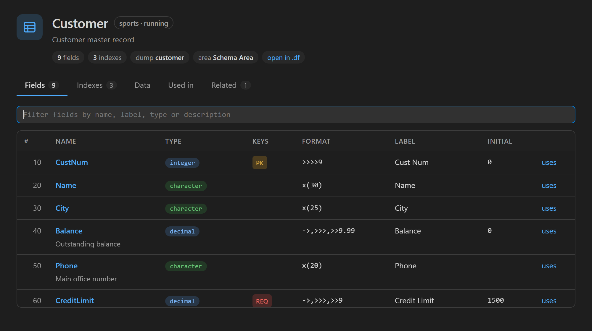
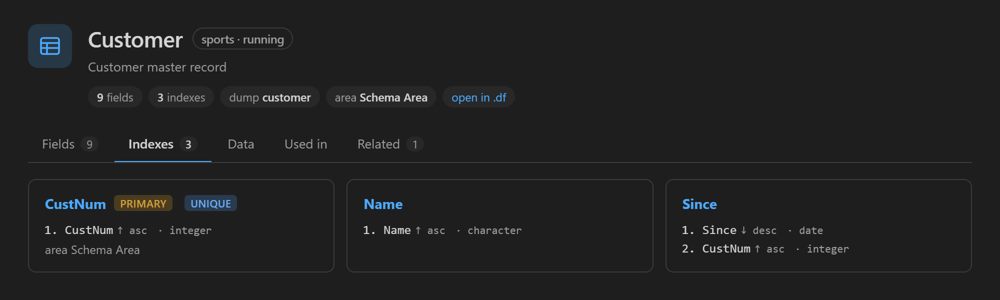
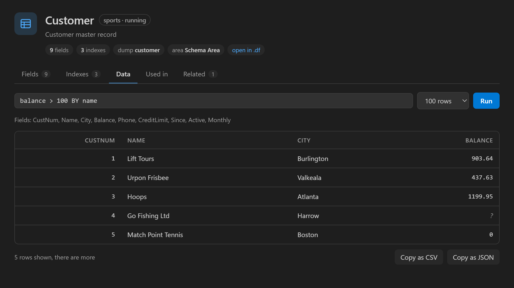
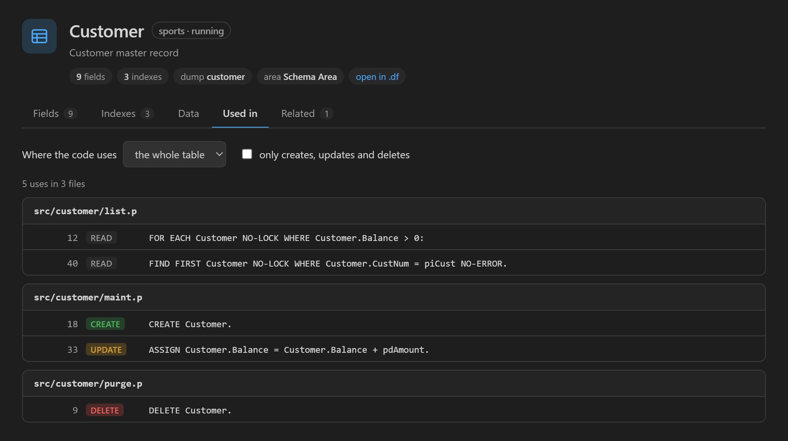

# ABL Language Server for OpenEdge

OpenEdge ABL support for VS Code: a fast language server with go-to-definition, hover, completion, rename, lint with quick fixes, formatting and a database browser. It ships with the `abl` command line tool, so the same checks run in the editor, in a terminal and in CI.

The language features work on the source alone. An OpenEdge install is only needed for the things that run code: compile on save, and reading rows in the database browser.



## Features

### Editing

- **Go to definition, references and rename** across the workspace: variables, buffers, temp-tables, procedures, functions, classes, methods, include files and database fields. Each occurrence is resolved, so same-named variables in other scopes are left alone. Renaming a method also renames its overrides.
- **Hover** with the declaration, the type a `LIKE` resolves to, the full keyword for an abbreviation (`DEF` is `DEFINE`), and the value a `{&NAME}` expands to.
- **Completion** for fields after `tt.` and `buffer.`, class members after `obj:` (inherited ones too), handle attributes and methods after `SESSION:`, `hBuf:` or `BUFFER x:`, procedures after `RUN`, and keywords in your case.
- **Signature help** for functions, methods, built-in functions, `NEW Class(` and `RUN proc (`, with overloads chosen by the argument types.
- **Classes**: chains like `oSvc:GetOrder():Customer:Name`, static access, `CAST`, `SUPER:` and `THIS-OBJECT:`. Missing interface members, a missing `OVERRIDE` and an `OVERRIDE` with nothing to override are reported.
- **Preprocessor**: `&GLOBAL-DEFINE` and `&SCOPED-DEFINE` are tracked through include files, `&IF` conditions are evaluated, and branches that aren't taken are dimmed.
- **Built-in reference**: hover and completion for the built-in functions and handles, `Progress.Lang.*`, `Progress.Json.ObjectModel.*` and the common .NET types (`System.String`, `StringBuilder`, `List`, `Dictionary`, `File`, `Path` and more).
- **Outline, workspace symbols (Ctrl+T), folding, highlights and semantic highlighting.**

### Checking

- **Diagnostics as you type**: unterminated strings and comments, unbalanced brackets, a missing or wrong `END`, a missing final period, duplicate definitions, and include files missing from the PROPATH.
- **Lint rules**, each set to `off`, `hint`, `info`, `warning` or `error`: unused parameters, variables and buffers, `DEFINE VARIABLE` without `NO-UNDO`, `FIND` without `NO-ERROR`, `FOR EACH` and `FIND` on database tables without a lock, and abbreviated keywords.
- **Quick fixes** (Ctrl+.): Add NO-UNDO, Add NO-ERROR, Add NO-LOCK, Expand to DEFINE, ignore a rule on one line, or fix everything in the file. Fix-all can also run on save.
- **Compile on save**: with an OpenEdge install, the real compiler checks each `.p`, `.w`, `.cls` and `.t` you save, and its errors show next to the others.

### Formatting

- **Format Document and Format Selection** indent one level per block, line `END` up with its header, keep continuation lines where they are, and trim trailing white space.
- **Keyword case**: `abl.format.keywordCase` makes keywords upper or lower case, or leaves them as written.

### Database browser

The ABL view in the activity bar lists the databases in your `abl.toml` with their tables and sequences, read from the `.df` files, so it works without OpenEdge. Ctrl+Alt+D finds a table by name, label or description.

A table opens as a page with tabs:

- **Fields**: type, keys, required, format, label and initial value, with a filter. A field name jumps to its definition in the `.df`.
- **Indexes**: their fields in order, ascending or descending, and whether they are primary, unique or word indexes.
- **Data**: rows from a `WHERE ... BY ...` you type, which you can copy as CSV or JSON. This tab needs OpenEdge and the database.
- **Used in**: every place the code reads, creates, updates or deletes the table or a field, grouped by file. A line opens the code.
- **Related**: the tables this one refers to and the ones that refer to it, matched by field name.







### Database schema in the code

With the `.df` files in `abl.toml` (or the `abl.schema` setting), table and field names get go-to-definition into the `.df`, hover with the type, format, label and description, and completion after `customer.`, `buffer.` and `dbname.`. Unqualified field names in a `WHERE` resolve to the table they belong to.

### Compiled r-code

`.r` files can get their own icon. VS Code gives `.r` to the R language by default, so the extension leaves it alone until you opt in: add `"files.associations": { "*.r": "abl-rcode" }` to your workspace settings. With the vscode-icons theme, which picks icons by extension, copy `media/rcode.svg` from the extension to `vsicons-custom-icons/file_type_abl-rcode.svg` next to your user settings, add `"vsicons.associations.files": [{ "icon": "abl-rcode", "extensions": ["r"], "format": "svg" }]`, and run "vscode-icons: Apply Icons Customization". The same works for source files, one entry each: `procedure.svg` for `p`, `class.svg` for `cls`, `window.svg` for `w`, `include.svg` for `i` and `trigger.svg` for `t`, copied as `file_type_abl-<name>.svg` with `"icon": "abl-<name>"`.

## Getting started

1. Install the extension and open a folder of `.p`, `.w`, `.i` or `.cls` files. The editing features work right away.
2. For PROPATH, databases and compiling, add an `abl.toml` to the project root, by hand or with `abl init` from the [command line tool](https://github.com/connor-ve/abl-lsp/releases):

```toml
oe = "12.8"                     # register the install once: abl oe add 12.8 C:\Progress\OpenEdge
propath = ["src", "src/include"]

[db.sports]
schema = "db/sports.df"         # tables and fields for the editor and the database browser

[format]
keyword-case = "upper"

[lint]
for-each-without-lock = "error"
```

Without an `abl.toml`, the `abl.propath`, `abl.schema`, `abl.lint` and `abl.preprocessor` settings do the same job.

## Settings

| Setting | What it does |
|---|---|
| `abl.propath` | Folders for include files, `RUN` targets and classes. Empty means the workspace folders. |
| `abl.schema` | `.df` files that give the editor database tables and fields. |
| `abl.preprocessor` | Names defined before every file, as if by `&GLOBAL-DEFINE`. |
| `abl.lint` | The level of each lint rule. |
| `abl.format.keywordCase` | `preserve`, `upper` or `lower`. |
| `abl.diagnostics.unresolvedIncludes` | Warn when an include file can't be found. |
| `abl.compileOnSave` | Check saved files with the OpenEdge compiler. |
| `abl.serverPath` | Use another `abl` executable instead of the bundled one. |
| `abl.trace.server` | Log language server traffic to the output channel. |

## Commands

| Command | Shortcut |
|---|---|
| ABL: Open Database Table... | Ctrl+Alt+D |
| ABL: Refresh (database browser) | |
| ABL: Restart Language Server | |

## The command line tool

The extension runs the `abl` tool that comes with it. On its own, `abl` also compiles and builds `.pl` libraries, runs procedures, runs ABLUnit tests (with JUnit output for CI), formats and lints whole projects, manages local databases, queries and exports data, installs packages from git, and checks the project against your own advisories. See the [repository](https://github.com/connor-ve/abl-lsp) for the full list.

## Requirements and limits

- **Windows x64.** The bundled `abl` is a Windows build.
- **OpenEdge** is only needed for compile on save and for rows in the database browser. 11.7 and later are the target.
- Include files are read, not inlined: blocks an include opens or closes aren't seen, and code inside an include doesn't know the variables of the file that includes it.
- The database browser shows the schema from the `.df` files, not from a running database.
- This is a preview. The parts that run inside OpenEdge (compile on save, reading rows) are tested against a stand-in, not yet across real OpenEdge versions. Please report what you find in the [issues](https://github.com/connor-ve/abl-lsp/issues).

## Developer note

This extension was built without an OpenEdge license, so everything that runs OpenEdge (compile on save, rows in the database browser, and `abl` commands such as `compile`, `run`, `test`, `db` and `pas`) has only been tested against a stand-in, never a real install. Those parts may fail on real OpenEdge. The editor features don't need OpenEdge and work fully. If something breaks, please open an [issue](https://github.com/connor-ve/abl-lsp/issues) with the output.

## License

MIT. Not affiliated with or endorsed by Progress Software Corporation. Progress, OpenEdge and ABL are trademarks of Progress Software Corporation.
